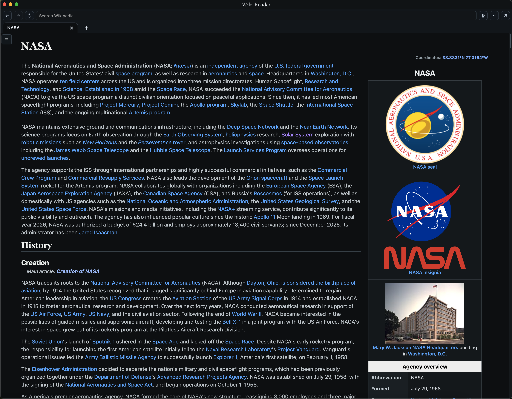
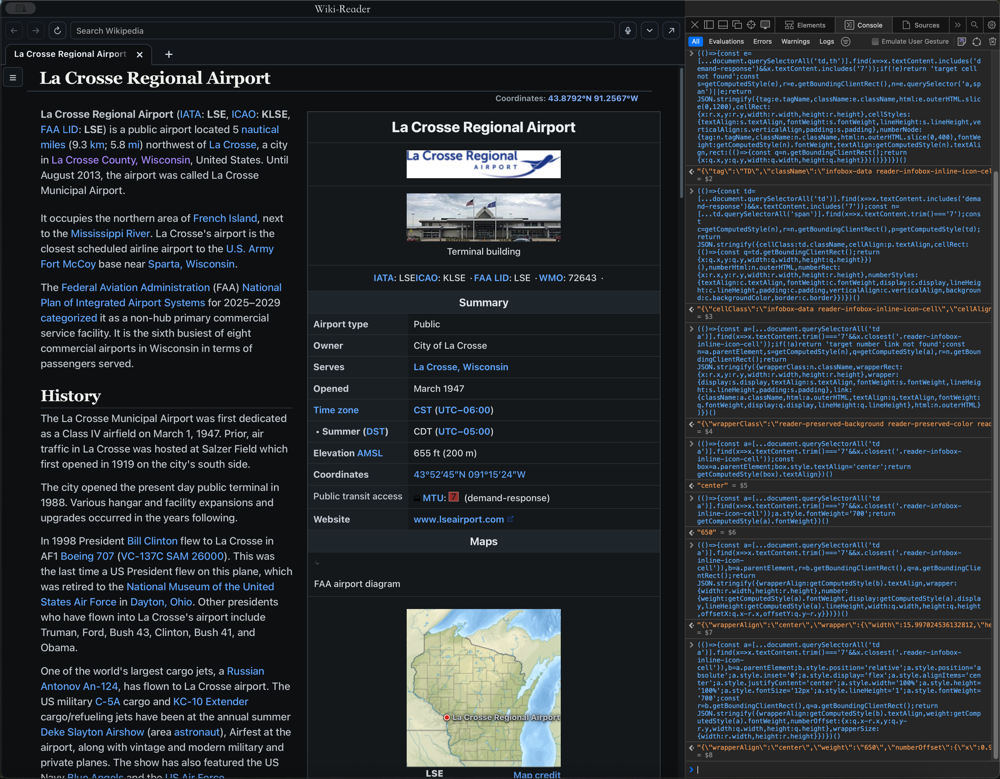

# Wiki-Reader

A native desktop Wikipedia reader for searching articles

  

## License

The Wiki-Reader source code is licensed under the Apache License, Version 2.0. See [LICENSE](LICENSE) for the full license text.

The names “Wiki Reader” and “Wiki-Reader,” along with the project logo and branding, are reserved by the project owner and are not licensed for use in branding forks or implying official affiliation. See [TRADEMARKS.md](TRADEMARKS.md) for the project’s name and trademark policy.

## Contributing

Wiki-Reader was built with help from OpenAI Codex by a maintainer with no programming experience. If your pull request changes the app's appearance, please consider including before-and-after screenshots when applicable, along with a brief plain-language description of what changed. This is a suggestion to help the maintainer review contributions; screenshots are not needed for changes with no visual impact.

### Development workflow

Use [Tauri](https://en.wikipedia.org/wiki/Tauri_(software_framework))'s Web Inspector [DOM](https://en.wikipedia.org/wiki/DOM_Inspector) (⌘⌥I Command Option I on macOS) to inspect, test, diagnose, and optimize the Wiki-Reader app live before doing a local patch and pull request.

  

